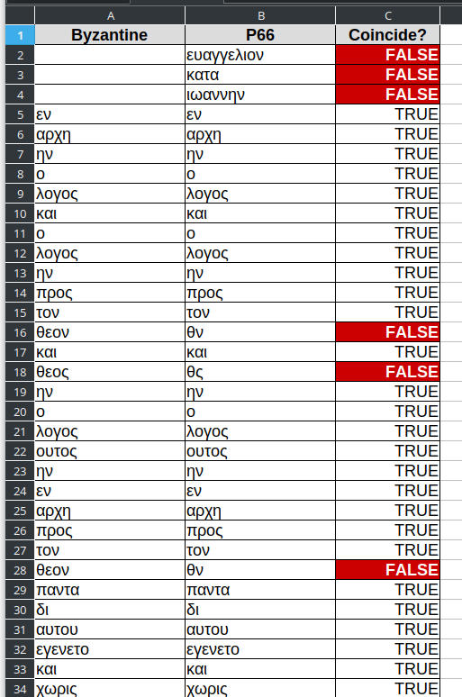

# Using CollateX with the Byzantine text

This page walks through collating the unaccented Byzantine TEI with an INTF
manuscript transcription using CollateX. The worked example compares the
Byzantine text with a transcription of P66.

You can download the CollateX software from this URL:
<https://collatex.net/download/>

Let's suppose you want to compare P66 with the Byzantine text of John 1. You can
get the transcription of P66 from the INTF here:
<https://ntvmr.uni-muenster.de/community/vmr/api/transcript/get/?docID=10066&indexContent=John%201&pageID=ALL&format=teiraw>
and the Byzantine text from the current edition,
[`editions/rp2018-2023/tei/unaccented/`](../editions/rp2018-2023/tei/unaccented/).

For this demo, we prepared a TEI file with only the first chapter of the
Byzantine John. You can find it [here](assets/demo_john_1.xml). If you try to
run CollateX on the entire book, it will take some time.

`demo_john_1.xml` is a hand-prepared single-chapter extract of
[`editions/rp2018-2023/tei/unaccented/JOH.xml`](../editions/rp2018-2023/tei/unaccented/JOH.xml).
It is a demo asset, not a pipeline output, so the build never regenerates it.

Save the files. For example: `p66.xml` and `demo_john_1.xml`.

Then run CollateX with the following command:

```bash
java -jar collatex-tools-1.7.1.jar -xp '//w' -xml -f csv -t demo_john_1.xml p66.xml > collation.csv
```

The [resulting file](assets/demo_collation.xlsx) (with a little bit of Excel
formatting) looks like this:


